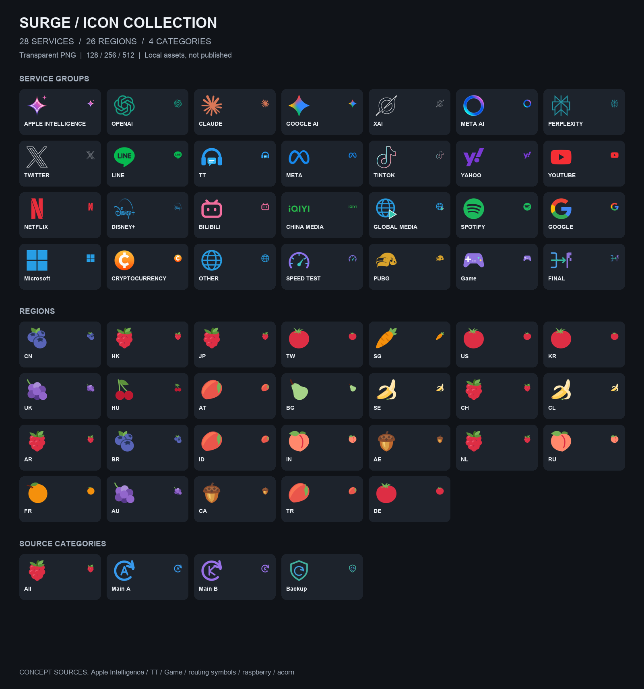
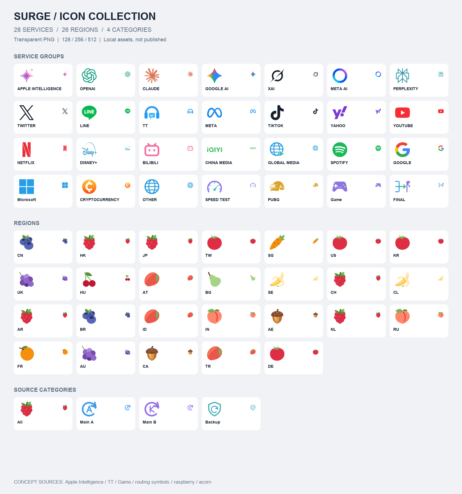

# Surge Icons · 透明策略組圖示

為 **Surge iOS / macOS** 整理的透明 PNG 策略組圖示集，使用色彩鮮明、圖案獨立的視覺風格，**不附加 App 方形底板**。

目前包含 **43 款圖示 × 3 種尺寸（128／256／512 px）＝ 129 張 PNG**。對應 **28 個服務組、26 個地區組與 4 個訂閱來源分類**；多個策略組可共用同一款圖示。所有 PNG 都經本地尺寸與 Alpha 通道檢查。實際 Surge iOS／macOS 顯示效果仍建議在設備上驗收。

## 📌 更新紀錄

- **2026-11-08**：已更新 8 款純圖案透明底策略組圖示：Grok (xai)、Twitter 藍鳥、TikTok 純黑音符、Cryptocurrency 比特幣、Disney+、Global Media、Other、FINAL（漏網之魚）。
- 8 款皆覆蓋 `png/128/`、`png/256/`、`png/512/` 原有檔名，既有 Surge `icon-url` 不必修改；可編輯向量圖存放在 `sources/production/`。
- Apple Intelligence / Siri AI 暫不修改，待新設計確認後才更新。現有全套深淺色總覽仍是首次上架時的預覽，未反映這次八款更新，請以 `png/` 目錄實際檔案為準。

## 👀 預覽

### 深色模式



### 淺色模式



> 上方卡片背景只存在於預覽圖；`png/` 內的每張素材均是真正的透明 PNG。

## 🚀 Surge 使用方法

進入 Surge 配置檔的 `[Proxy Group]` 區段，在對應策略組**原有那一行**加入或替換 `icon-url`，其他代理、策略組、排序、正則與分流參數都不用動。

```ini
# 例：Apple Intelligence
APPLE INTELLIGENCE = select, "🇯🇵 JP", "🇸🇬 SG", "🇺🇸 US", icon-url=https://raw.githubusercontent.com/AceyDeng/icon/main/png/256/apple-intelligence.png
```

**圖示 Raw URL 規則：**

```text
https://raw.githubusercontent.com/AceyDeng/icon/main/png/256/<filename>.png
```

例如：

- [Apple Intelligence](png/256/apple-intelligence.png)：`https://raw.githubusercontent.com/AceyDeng/icon/main/png/256/apple-intelligence.png`
- [OpenAI](png/256/openai.png)：`https://raw.githubusercontent.com/AceyDeng/icon/main/png/256/openai.png`
- [香港／日本覆盆子](png/256/raspberry.png)：`https://raw.githubusercontent.com/AceyDeng/icon/main/png/256/raspberry.png`
- [Main A](png/256/main-a.png)：`https://raw.githubusercontent.com/AceyDeng/icon/main/png/256/main-a.png`

現成圖示對應：
- [`surge-icons-map.csv`](surge-icons-map.csv)：包含組名與**實際可引用的 Raw URL**；
- [`Surge-Proxy-Group-icon-only.conf`](Surge-Proxy-Group-icon-only.conf)：僅供替換 `icon-url` 的參照表，**不是完整設定檔，不要直接整段匯入**；
- [`tools/apply-icon-urls.py`](tools/apply-icon-urls.py)：如有完整原配置，可另存只修改 `icon-url` 的副本，不覆寫原件。

## 🧩 服務策略組（28）

| 策略組 | PNG |
|---|---|
| `APPLE INTELLIGENCE` | [apple-intelligence.png](png/256/apple-intelligence.png) |
| `OPENAI` | [openai.png](png/256/openai.png) |
| `CLAUDE` | [claude.png](png/256/claude.png) |
| `GOOGLE AI` | [google-ai.png](png/256/google-ai.png) |
| `XAI` | [xai.png](png/256/xai.png) |
| `META AI` | [meta-ai.png](png/256/meta-ai.png) |
| `PERPLEXITY` | [perplexity.png](png/256/perplexity.png) |
| `TWITTER` | [twitter.png](png/256/twitter.png) |
| `LINE` | [line.png](png/256/line.png) |
| `TT` | [tt.png](png/256/tt.png) |
| `META` | [meta.png](png/256/meta.png) |
| `TIKTOK` | [tiktok.png](png/256/tiktok.png) |
| `YAHOO` | [yahoo.png](png/256/yahoo.png) |
| `YOUTUBE` | [youtube.png](png/256/youtube.png) |
| `NETFLIX` | [netflix.png](png/256/netflix.png) |
| `DISNEY+` | [disney-plus.png](png/256/disney-plus.png) |
| `BILIBILI` | [bilibili.png](png/256/bilibili.png) |
| `CHINA MEDIA` | [china-media.png](png/256/china-media.png) |
| `GLOBAL MEDIA` | [global-media.png](png/256/global-media.png) |
| `SPOTIFY` | [spotify.png](png/256/spotify.png) |
| `GOOGLE` | [google.png](png/256/google.png) |
| `Microsoft` | [microsoft.png](png/256/microsoft.png) |
| `CRYPTOCURRENCY` | [cryptocurrency.png](png/256/cryptocurrency.png) |
| `OTHER` | [other.png](png/256/other.png) |
| `SPEED TEST` | [speed-test.png](png/256/speed-test.png) |
| `PUBG` | [pubg.png](png/256/pubg.png) |
| `Game` | [game.png](png/256/game.png) |
| `FINAL` | [final.png](png/256/final.png) |

## 🍇 國家與地區（26）

依照原 Surge 截圖採用水果／物件圖示。不同地區有意共用同一個水果圖案，以保留使用者目前的分類習慣。

| 地區策略組 | PNG |
|---|---|
| `CN` | [blueberry.png](png/256/blueberry.png) |
| `HK` | [raspberry.png](png/256/raspberry.png) |
| `JP` | [raspberry.png](png/256/raspberry.png) |
| `TW` | [tomato.png](png/256/tomato.png) |
| `SG` | [carrot.png](png/256/carrot.png) |
| `US` | [tomato.png](png/256/tomato.png) |
| `KR` | [tomato.png](png/256/tomato.png) |
| `UK` | [grape.png](png/256/grape.png) |
| `HU` | [cherry.png](png/256/cherry.png) |
| `AT` | [mango.png](png/256/mango.png) |
| `BG` | [pear.png](png/256/pear.png) |
| `SE` | [banana.png](png/256/banana.png) |
| `CH` | [raspberry.png](png/256/raspberry.png) |
| `CL` | [banana.png](png/256/banana.png) |
| `AR` | [raspberry.png](png/256/raspberry.png) |
| `BR` | [blueberry.png](png/256/blueberry.png) |
| `ID` | [mango.png](png/256/mango.png) |
| `IN` | [peach.png](png/256/peach.png) |
| `AE` | [acorn.png](png/256/acorn.png) |
| `NL` | [raspberry.png](png/256/raspberry.png) |
| `RU` | [peach.png](png/256/peach.png) |
| `FR` | [orange.png](png/256/orange.png) |
| `AU` | [grape.png](png/256/grape.png) |
| `CA` | [acorn.png](png/256/acorn.png) |
| `TR` | [mango.png](png/256/mango.png) |
| `DE` | [tomato.png](png/256/tomato.png) |

## ✈️ 訂閱來源分類（4）

| 分類 | PNG |
|---|---|
| `All` | [raspberry.png](png/256/raspberry.png) |
| `Main A` | [main-a.png](png/256/main-a.png) |
| `Main B` | [main-b.png](png/256/main-b.png) |
| `Backup` | [backup.png](png/256/backup.png) |

主力地區的隱藏 Main A / Main B / Main / Backup 分層組使用相同地區水果，沒有為每層額外複製一套圖案。

## 📁 目錄

```text
png/
  128/       # 43 款 PNG
  256/       # 43 款 PNG（建議 Surge 使用）
  512/       # 43 款 PNG
previews/
  dark.png
  light.png
sources/production/  # 可編修的向量製作檔（適用項目）
licenses/            # 第三方授權文本
manifest.json        # 素材來源、修改方式與圖示映射
surge-icons-map.csv  # 策略組／檔名／Raw URL 對照
CREDITS.md           # 完整署名及來源
LICENSE.txt
```

## 🔏 授權與商標

這個專案**不是所有圖示都同一授權**。Twemoji 使用 CC BY 4.0，Lobe Icons 與其他來源的條款詳見 [`CREDITS.md`](CREDITS.md)、[`LICENSE.txt`](LICENSE.txt)、[`licenses/`](licenses/) 及 [`manifest.json`](manifest.json)。

Apple Intelligence、TT、Game、GLOBAL MEDIA、OTHER、SPEED TEST、FINAL 與部分水果／來源分類圖示為**非官方原創概念圖**，僅代表本策略組的識別圖形，不宣稱是官方商標。涉及第三方品牌的商標權仍歸相應權利人。

## 🛠️ 維護約定

- 保持檔名**小寫英文、連字符**，同一 `slug` 在三個尺寸資料夾保持一致。
- PNG 必須正方形且具有真透明 Alpha；不能把預覽棋盤格、圓角卡片或實色背景烘焙到 PNG 中。
- 更新素材時同步更新三個尺寸、兩張預覽、`surge-icons-map.csv`、來源及授權資訊。
- 不要把 Surge 節點密碼、訂閱 Token 或私密配置提交進此倉庫。

本倉庫僅存放圖示素材及其文件，不包含使用者的訂閱網址或實際連線設定。
